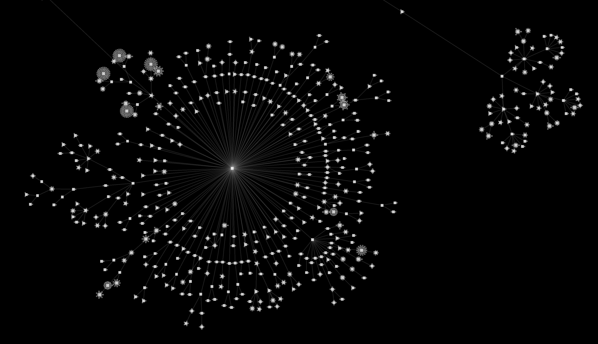

# weave
weave is a simple physics engine for a force-directed node graph



> Image from the `file_tree` demo

# dependency
_weave is not yet distributed in crates.io_

```toml
weave = { git = "https://github.com/ityeri/weave", tag = "v0.1.0" }
```

# demos
* `cargo run -p demos -r --example file_tree -- some/path/ -w 0.3 -l` : runs a file tree visualizer example. `-w` is a wheel sensitivity option. (0.3 is recommended)
* `cargo run -p demos -r --example twin_graph -- -w 0.3` : runs an example which simulates two central nodes and sub nodes of them.

# `Updater`
All updaters follow this trait: `Updater`.
Simply, it gets the previous data of `PhysicalGraph` and time delta **secondes**, and then returns the next frame of it.

```
fn update<K: NodeKey>(&self, graph: &PhysicalGraph<K>, dt: f32) -> PhysicalGraph<K>;
```

usage
```rust
use weave::updater::{SomeUpdaterImpl, Updater};

let updater: Updater = SomeUpdaterImpl::new();

let updated_graph = updater.update(physical_graph, 1.0 / 60.0);
```

## `DefaultUpdater`
Most simple, almost non-optimized except for multi-threading.
`DefaultUpdater::default_setting()` is a preconfigured setting which is appropriate for most of general case.
Time complexity is `O(n^2)`.

The number of incoming edges is treated as physical mass.
If two nodes are connected through the edge, they are connected with a physical edge which length is proportion with sum of each node's incomings.
If two nodes are non-neighbor, it pushes back on each other. (opposite of the general gravity force)

usage
```rust
use weave::updater::{DefaultUpdater, Updater};

let updater: Updater = DefaultUpdater::default_setting();

let updated_graph = updater.update(physical_graph, 1.0 / 60.0);
```


## `QuadTreeUpdater`
Optimized with the barnes-hut algorithm in the bouncing force part.

Basically, most of part is same as `DefaultUpdater`, but all nodes always push back on each other even if they are neighbor.
If they are neighbor, physical edges are graps node can't go too far.
Time complexity is approximately `O(E)` (E means the number of edges)

usage
```rust
use weave::updater::{QuadTreeUpdater, Updater};

let updater: Updater = QuadTreeUpdater::default_setting();

let updated_graph = updater.update(physical_graph, 1.0 / 60.0);
```

# to do
This project still has a long way to go.
It's developing for a million-to-billion scale node physics, but it's not enough to optimize for it.
Most development of this project will be optimization.

* GPGPU: wgpu or rust-gpu
* Dynamic grid

